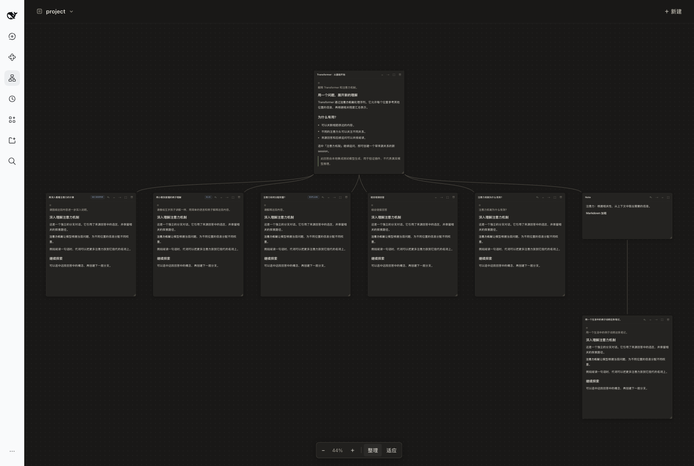
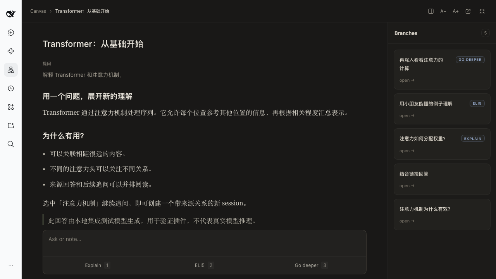
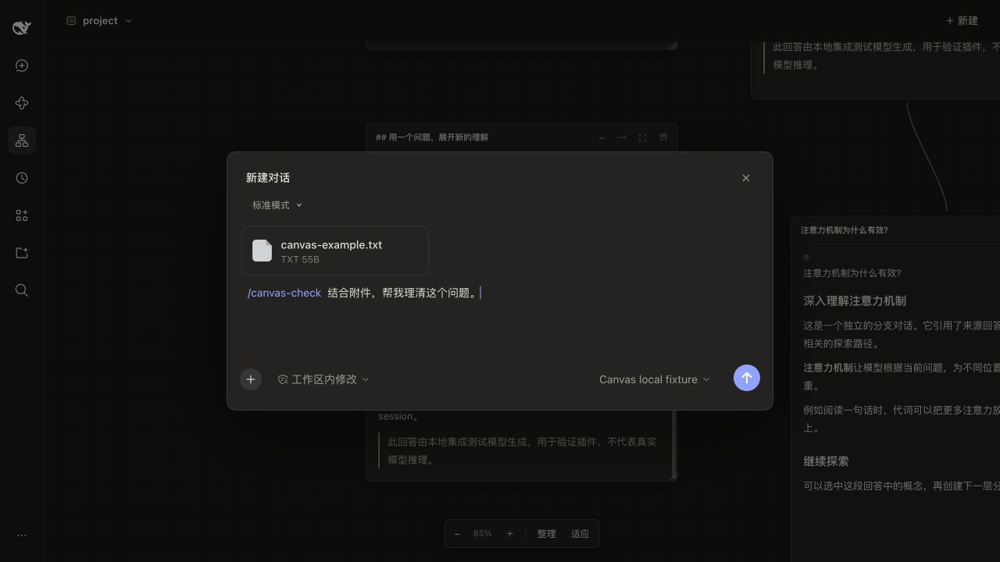

# BranchNest for DSH · 分支探索

在 DeepSeek Harness 的项目里，用无限画布管理对话、追问和笔记。

每个项目有一张画布。已有对话会作为独立卡片出现；选中回答中的文字发起追问，会创建保留来源的新对话，主线和分支可以各自继续。

直接使用 DSH 的会话、模型、权限和存储，无需外部 Rabbithole 应用或额外 API key。



| 阅读页 | 新建对话 |
|---|---|
|  |  |

## 安装

目前已验证 **macOS · DeepSeek Harness Desktop 0.2.1-rc.3**。

当前源码版本为 **0.4.4**，尚未创建 GitHub Release 安装包。可先从源码构建（需要 Node.js 22.18 或更高版本）：

```sh
git clone https://github.com/ForsakenDelusion/dsh-branchnest.git
cd dsh-branchnest
npm ci --legacy-peer-deps
npm run build
npm pack --ignore-scripts
```

然后将生成的安装包装入 Desktop：

```sh
"/Applications/DeepSeek Harness.app/Contents/Resources/runtime/cli/bin/dsh" \
  plugin --profile desktop add ./dsh-branchnest-0.4.4.tgz
```

完全退出并重新打开 DSH Desktop，在左侧导航选择 **分支探索**。安装包包含构建产物，安装包的使用者无需再次编译。

更新时安装新的 `.tgz` 并重启 Desktop。卸载插件：

```sh
"/Applications/DeepSeek Harness.app/Contents/Resources/runtime/cli/bin/dsh" \
  plugin --profile desktop remove dsh-branchnest
```

## 开始使用

完整操作说明见 [docs/usage.md](docs/usage.md)。五个常用动作：

- **管理项目对话**：切换项目查看对应画布，拖动卡片和空白区域；底部可缩放、整理和适应全部内容。
- **从内容继续追问**：选中回答中的文字，或点击卡片底部的 **Ask or note**。Ask 创建独立分支，Note 留下一张笔记。Explain、ELI5 和 Go deeper 可直接发起快捷追问。
- **阅读与编辑**：点击卡片右上角的展开按钮进入阅读页；双击 Note 正文即可编辑，点击外部自动保存。
- **新建对话**：右上角 **＋ 新建** 支持原生附件、`/` 技能和命令、`@` 文件或对话引用，以及模型和权限选择。MCP 使用 DSH 中已配置的工具。
- **明确引用其他卡片**：从标题栏的 **⇢** 拖向另一张卡片，之后的 Ask 会带入被引用内容；提交前可以排除本次不需要的引用。

## 数据与边界

聊天记录保存在 DSH 原生 session 中，画布布局、笔记和来源关系保存在 DSH 的 `project_canvas` 存储域。同一画布上的独立对话不会自动共享历史；分支携带选区、来源问答和必要祖先内容。

归档对话前会二次确认；归档保留聊天记录与布局，取消归档后可以恢复。权限遵循 DSH 的设置。

未发送的新建对话草稿可在当前客户端关闭重开、切换项目后继续；刷新、插件重载或退出后不保证保留。正在生成的回答需完成后才能作为分支来源。PDF 卡片、跨项目分支和导出暂未提供。

## 开发与反馈

需要 Node.js 22.18 或更高版本。构建、验证和 `dev` / `main` 发布流程见 [CONTRIBUTING.md](CONTRIBUTING.md)，更新记录见 [CHANGELOG.md](CHANGELOG.md)。

反馈问题时请附上 DSH 版本、插件版本、系统和复现步骤，也可以使用仓库的 Issue 模板。

## 致谢与许可

交互与视觉参考自 [Rabbithole](https://github.com/shlokkhemani/rabbithole)（Shlok Khemani，MIT 许可）。本项目是独立的非官方实现，与原作者没有隶属或背书关系。

本项目采用 [MIT License](LICENSE)，第三方版权与许可见 [THIRD_PARTY_NOTICES.md](THIRD_PARTY_NOTICES.md)。
